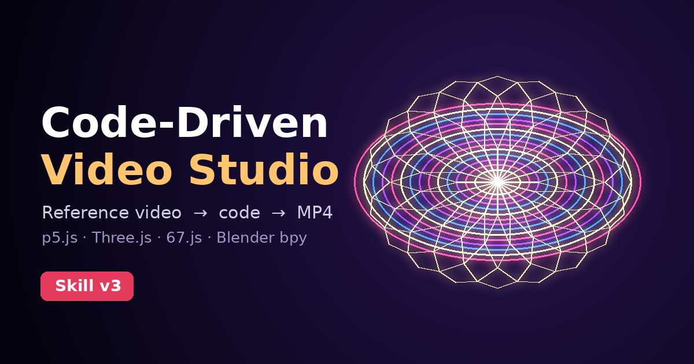

# Code-Driven Video Studio v3

A skill for coding agents: give it a reference video or an idea, and it writes deterministic code (p5.js, Three.js, 67.js or Blender bpy), renders an MP4 frame by frame, and scores it against the reference.

**Landing page:** https://abhi478jeetur-rgb.github.io/code-driven-video-studio/

## Examples

All example videos live here in this README. Each one has its code folder in `examples/`.

<!-- EXAMPLES:START -->
| # | Example | Engine | Video |
|---|---|---|---|
| 1 | Math art Short | p5-2d | coming soon |
| 2 | Stylised 3D scene | p5-webgl | coming soon |
| 3 | PBR product spin | three-hybrid | coming soon |
| 4 | Realistic 3D shot | Blender bpy / 67.js | coming soon |
<!-- EXAMPLES:END -->

## Quick start
    pip install numpy pillow opencv-python-headless
    npm i playwright && npx playwright install --with-deps chromium
    python3 tools/analyze.py ref.mp4 --out ana
    node tools/render.mjs templates/p5-2d --out test.mp4
    python3 tools/compare.py ref.mp4 test.mp4 ana/analysis.json
    # realistic 3D (Blender 4.x)
    bash templates/blender/render_blender.sh templates/blender/scene.py test3d.mp4 draft

## Pick the engine
| Need | Engine |
|---|---|
| 2D, math art, text, particles, UI motion | p5-2d |
| stylised 3D (low-poly, toon) | p5-webgl |
| PBR, bloom, many instances, glTF | three-hybrid |
| realistic 3D, rigs, HDRI, path tracing | 67.js (MCP) or Blender bpy |
| photo-real static background | Gaussian splats (Spark) |

## What's new in v3
- Realistic 3D path: 67.js (MIT, MCP-driven, Glaze raster + Cook path tracer) as main, Blender bpy + EEVEE as backup.
- `templates/blender/`: code-only bpy scene with the same KF timeline, plus `render_blender.sh` with draft/final/cycles presets that fit a 4 GB GPU.
- `tools/track_camera.py` (COLMAP camera solve to KF json) and `tools/pose.py` (MediaPipe pose to BVH for retargeting).
- Honest ceiling: about 70–90% of a realistic look with good assets, a rig and HDRI light. A video can't be turned back into its original code, and the original characters are never copied.
- p5-webgl is now marked stylised only.
- Dropped: Anime.js, Vivus, Flubber, tsParticles, shadcn, Matter (the KF timeline and seeded particles cover them).

## Layout
    SKILL.md           the skill (give this to the agent)
    LESSONS.md         lessons learned per video
    core/              studio-core.js (rng, easings, kf timeline)
    templates/         p5-2d, p5-webgl, three-hybrid, blender
    tools/             analyze, render, compare, mix_audio, track_camera, pose
    examples/          finished example projects
    docs/              landing page + OG image

## Tested
analyze.py and compare.py were run on a test clip. All JS passes `node --check`, all Python compiles. render.mjs, the web templates, the Blender template, pose.py and track_camera.py were not run in the build sandbox (no working Chromium, Blender, COLMAP or GPU there). The first run on your machine is the real test.

MIT license.
